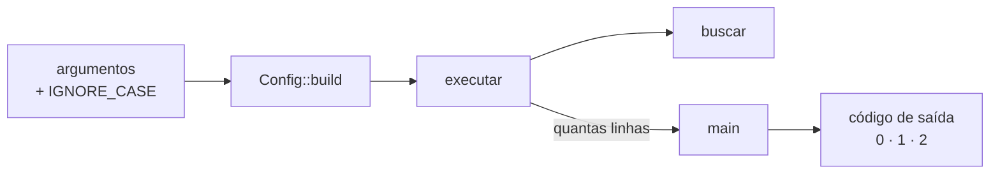

# 🔎 minigrep


Formatura do [MC2 · Rust do zero](../README.md): um `grep` pequeno que procura um texto nas linhas de um arquivo. Baseado no projeto do Rust Book ([cap. 12](https://doc.rust-lang.org/book/ch12-00-an-io-project.html) e [13.3](https://doc.rust-lang.org/book/ch13-03-improving-our-io-project.html)), só com a biblioteca padrão e com testes desde o primeiro arquivo.

## 🚀 Como rodar

Pré-requisito: Rust estável com Cargo ([rustup](https://rustup.rs/)).

```bash
cd mc2-rust/minigrep
cargo run -q -- fogo exemplos/bestiario.txt          # diferencia maiúsculas
cargo run -q -- -n -i fogo exemplos/bestiario.txt    # ignora maiúsculas e numera
IGNORE_CASE=1 cargo run -q -- mímico exemplos/bestiario.txt
./scripts/verde.sh                                   # fmt + Clippy + testes
```

Saída do segundo comando:

```text
3:Slime: fraco contra fogo; aparece em bandos perto da água.
5:Dragão Vermelho: imune a fogo; foge quando perde metade da vida.
7:Fênix: renasce do Fogo e só cai com gelo.
```

## 🧭 Uso

```text
minigrep [-i | -s] [-n] CONSULTA ARQUIVO
```

| Opção           | O que faz                                                       |
| --------------- | --------------------------------------------------------------- |
| `-i`            | Ignora maiúsculas e minúsculas, inclusive com acento (`MÍMICO`) |
| `-s`            | Diferencia maiúsculas e minúsculas (o padrão)                   |
| `-n`            | Mostra o número de cada linha (`3:...`)                         |
| `IGNORE_CASE=1` | Variável de ambiente: liga o `-i` sem escrever a opção          |

As opções valem em qualquer posição. **Uma opção sempre ganha da variável de ambiente**, e entre `-i` e `-s` vale a última (o exercício de precedência proposto no fim do [12.5](https://doc.rust-lang.org/book/ch12-05-working-with-environment-variables.html)).

O código de saída segue o do [`grep`](https://www.gnu.org/software/grep/manual/grep.html#Exit-Status), para o `minigrep` funcionar em scripts (`if minigrep ...; then`):

| Código | Quando                                                        |
| ------ | ------------------------------------------------------------- |
| `0`    | Achou pelo menos uma linha                                    |
| `1`    | Não achou nenhuma                                             |
| `2`    | Erro (argumento errado ou arquivo ilegível), sempre no stderr |

## 🏗️ Como funciona



| Peça            | Onde          | Papel                                                                     |
| --------------- | ------------- | ------------------------------------------------------------------------- |
| `buscar`        | `src/lib.rs`  | Esteira preguiçosa (`impl Iterator`) de `Ocorrencia { numero, linha }`    |
| `Config::build` | `src/lib.rs`  | Lê as opções de qualquer iterador de `String`; erros em `ErroArgs`        |
| `executar`      | `src/lib.rs`  | Lê o arquivo e escreve as linhas em `&mut impl Write`; devolve a contagem |
| `main`          | `src/main.rs` | Lê o ambiente, chama a biblioteca, imprime os erros e escolhe o código    |

### Decisões (e onde saí do livro)

- **Tudo o que dá para testar fica no `lib.rs`.** A versão atual do livro deixa `Config` e `run` no `main.rs` e leva só o `search`; aqui o `main.rs` ficou só com o ambiente e os erros.
- **Ambiente injetado.** O `main` lê o `IGNORE_CASE` e passa um `bool` para o `Config::build`. Na edição 2024, `std::env::set_var` é `unsafe`, e o pacote proíbe `unsafe` (`unsafe_code = "forbid"`): os testes nunca mexem no ambiente do próprio processo.
- **Saída injetada.** O `executar` escreve em `&mut impl Write`: a tela no executável, um `Vec<u8>` nos testes.
- **Uma função de busca com `enum Caixa`,** no lugar de `search` e `search_case_insensitive`: cada `impl Iterator` é um tipo opaco diferente, e um `if` que escolhesse entre duas funções não compilaria (E0308).
- **`buscar` devolve `impl Iterator`,** a melhoria que o 13.3 sugere: cada linha é escrita assim que é encontrada, sem `Vec` intermediário. Numerar (`enumerate`) vem antes de filtrar.
- **`fn main() -> ExitCode`** no lugar do `process::exit`, que [não roda os destrutores](https://doc.rust-lang.org/std/process/fn.exit.html).
- **Erros com contexto:** `ErroArgs` com `Display` + `Error` (no lugar do `&'static str`) e o nome do arquivo na mensagem de leitura (`minigrep: x.txt: No such file or directory`).

## 🧪 Testes

| Tipo             | Onde              | Quantos | O que cobrem                                                           |
| ---------------- | ----------------- | ------- | ---------------------------------------------------------------------- |
| Unitários        | `src/lib.rs`      | 14      | Busca (caixa, acentos, `\r\n`, consulta vazia), opções, erros, escrita |
| De ponta a ponta | `tests/cli.rs`    | 4       | O executável de verdade: stdout, stderr, códigos 0/1/2, `IGNORE_CASE`  |
| De documentação  | `///` do `lib.rs` | 2       | Os exemplos da API compilam e rodam                                    |

Os testes de ponta a ponta rodam o binário com `std::process::Command` e `env!("CARGO_BIN_EXE_minigrep")`, e mudam o ambiente só do processo filho. O `exemplos/bestiario.txt` também é a _fixture_ dos testes.

## ⚠️ Limitações conhecidas

- Uma consulta que começa com `-` (ex.: `-5`) é lida como opção; o `grep` resolve isso com `--` ou `-e`.
- Um arquivo por vez, lido inteiro na memória, e só UTF-8.
- Busca por texto, sem expressões regulares.
- Argumento que não é Unicode válido dá panic (`env::args`; a alternativa seria `env::args_os`).

## 📁 Estrutura

```text
minigrep/
├── Cargo.toml            # sem dependências; [lints] com pedantic e missing_docs
├── rustfmt.toml
├── scripts/verde.sh      # o botão verde: fmt --check, Clippy -D warnings, testes
├── exemplos/bestiario.txt
├── src/lib.rs            # buscar, Config, ErroArgs, executar
├── src/main.rs           # ambiente, erros e código de saída
└── tests/cli.rs          # testes de ponta a ponta
```

## 🔗 Referências

- [Rust Book, cap. 12: um projeto de E/S](https://doc.rust-lang.org/book/ch12-00-an-io-project.html) · [13.3: melhorando o projeto](https://doc.rust-lang.org/book/ch13-03-improving-our-io-project.html)
- [Edition Guide: captura de lifetimes em `impl Trait` (2024)](https://doc.rust-lang.org/edition-guide/rust-2024/rpit-lifetime-capture.html)
- [Cargo: variáveis de ambiente para crates](https://doc.rust-lang.org/cargo/reference/environment-variables.html) · [`[lints]`](https://doc.rust-lang.org/cargo/reference/manifest.html#the-lints-section)
- [ripgrep](https://github.com/BurntSushi/ripgrep), o grep completo (e muito rápido) feito em Rust
